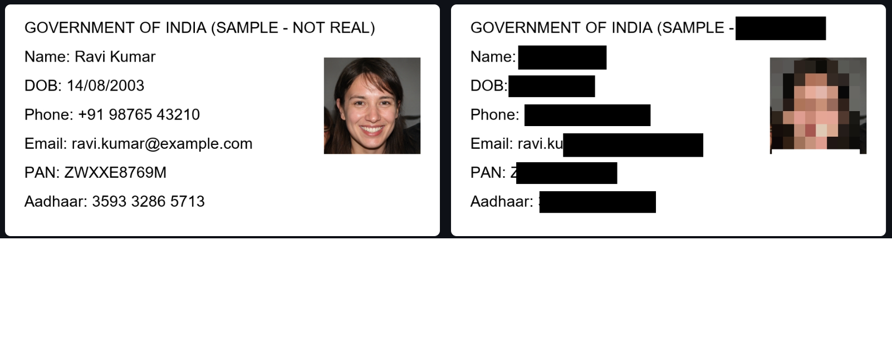
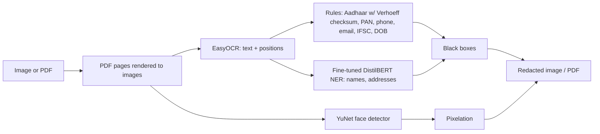

# 🔒 PII Redactor

An offline tool that automatically finds and hides personal information in scanned documents and PDFs, built for **Indian documents** such as Aadhaar cards, PAN cards and bank statements.

Upload an image or PDF and it blacks out Aadhaar and PAN numbers, phone numbers, emails, dates of birth, IFSC codes, **names and addresses**, and pixelates **faces**. Everything runs locally: no document ever leaves your computer.



## Why

People in India share photocopies of ID cards constantly: for SIM cards, rentals, college admissions and job applications. Each copy exposes enough data for identity fraud. This tool removes it before sharing.

## Results

Name and address detection uses a DistilBERT model I fine-tuned for Indian names and addresses. To measure it honestly, I built a separate **hard test set** with formats, addresses and company names that never appear in training, plus simulated OCR errors (e.g. `O→0`, `l→1`).

The first model looked perfect on a test set drawn from the training distribution (F1 1.00), but the hard test exposed real weaknesses: lowercase names were missed and company names like "Ashok Leyland Ltd" were tagged as people. After targeted data augmentation and adding a confidence threshold:

| Hard test set (500 examples, threshold 0.8) | v1 | v2 |
|---|---|---|
| Recall | 0.852 | **0.985** |
| Precision | 0.686 | **0.899** |
| F1 | 0.760 | **0.940** |

Recall is prioritised over precision, because in a privacy tool a missed name is a leaked name. The threshold of 0.8 was chosen as the highest value that kept recall unchanged. Full results are in [`results/`](results/).

## How it works



Some design decisions:

- **Aadhaar checksum validation.** Real Aadhaar numbers end in a Verhoeff check digit. Validating it stops random 12-digit numbers (invoice IDs, account numbers) from being flagged.
- **Synthetic training data.** No public labelled dataset of Indian ID text exists (for good privacy reasons), so training data is generated with Faker (`en_IN`) using templates that mirror real documents.
- **Avoiding data leakage.** Companies, areas and sentence formats in the training data are deliberately different from those in the hard test set, so improvements reflect generalisation rather than memorisation.
- **Irreversible PDF redaction.** Drawing black boxes over PDF text often leaves the text selectable underneath, a mistake that has leaked real confidential documents. Pages are instead rendered to images, redacted, and rebuilt into a new PDF.
- **OCR-tolerant detection.** Testing showed the OCR reading the PAN `EAPHU6756D` as `EAPHU67S6D` and dropping the dot in an email. A PAN always has the shape 5 letters, 4 digits, 1 letter, so each character is repaired by position (e.g. `S`→`5` in a digit slot) before matching. Redaction boxes also get a small safety margin, since hiding slightly too much beats leaking part of a number.
- **Pixelation instead of blur.** Light blurs can sometimes be partially reversed; pixelation discards the detail.
- **Masked output.** The findings table shows only the last 4 characters (e.g. `XXXX XXXX 9012`), so the app never displays the data it hides.

## Tech stack

Python, PyTorch, Hugging Face Transformers (DistilBERT), EasyOCR, OpenCV (YuNet), PyMuPDF, Faker, Streamlit

## Setup

```bash
git clone https://github.com/AbhyudayaS856/pii-redactor.git
cd pii-redactor
python -m venv venv
venv\Scripts\activate            # Windows  (macOS/Linux: source venv/bin/activate)
pip install -r requirements.txt
```

The trained NER model is too large for GitHub (~260 MB), so recreate it (about 20 minutes on a laptop CPU):

```bash
python generate_data.py     # 6,000 training + 600 test examples
python train_ner.py         # fine-tunes DistilBERT -> models/ner/
```

Optionally, evaluate it:

```bash
python make_hard_test.py
python evaluate.py
```

## Usage

```bash
streamlit run app.py                     # web app
python redactor.py document.png          # single image
python pdf_redactor.py document.pdf      # PDF
python make_sample.py                    # generate a FAKE test ID card
```

## Project structure

| File | Purpose |
|---|---|
| `app.py` | Streamlit web interface |
| `redactor.py` | Image pipeline: OCR, rules, NER, faces |
| `pdf_redactor.py` | Multi-page PDF redaction |
| `detectors.py` | Regex detectors and Verhoeff checksum |
| `ner.py` | Runs the fine-tuned NER model |
| `generate_data.py` | Synthetic training data |
| `train_ner.py` | Fine-tuning script |
| `make_hard_test.py` / `evaluate.py` | Hard test set and evaluation |
| `models/` | YuNet face model (NER model generated locally) |

## Limitations

- Trained and evaluated on synthetic data; accuracy on real scans will be lower, especially with poor image quality.
- OCR is English only; Kannada, Hindi and other scripts are not yet detected.
- Redaction box positions within a text line are estimated from character positions, so boxes are slightly padded.
- Redacted PDFs are image-based, so they are no longer text-searchable.
- Runs on CPU; a multi-page PDF takes a while.

## Privacy note

Never test with real ID documents in a public repository. `.gitignore` blocks all images and PDFs, and the included sample generator creates fake data only. The test face is AI-generated and does not belong to a real person.
